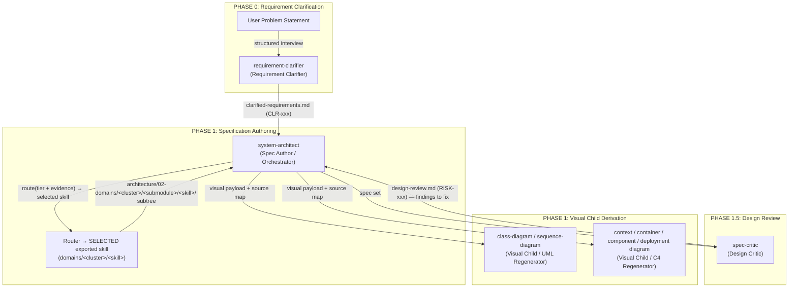

# SDD Inter-Skill Pipelines & Data Flows

## Visual Child Refactor Note

The diagram task skills in `exported_skills/tasks/07_system_modeling/` are visual child/regenerator skills of `system-architect`. They are not independent architecture phases and must not invent architecture, flows, classes, states, deployment units, or cross-context contracts.

`system-architect` owns C4/UML activation, source maps, skip reasons, and canonical templates. Visual children render derived artifacts from existing SSoT source paths and return coverage findings. Downstream skills consume diagrams only as derived evidence; they must cite requirements/contracts/stable IDs as primary source.

This document defines how the skills interact under the **Specification-Driven Development (SDD)** methodology. The core principle: **Specifications are the Single Source of Truth — everything else is derived.** The specification set it produces can be handed to an external dev team or implemented by the solo user; the implementation stage itself is outside this distribution.

## 1. SDD Pipeline Architecture

Input routing starts before the phase pipeline: a user requirement Markdown is a living Phase 0 source, while an explicit non-generated architecture `plan.md` routes directly to `01-system-architect`. Both remain `new` or `partial` until clause-level system-architect ingestion is complete. Before Phase 1 architecture execution, system-architect proposes a registered `architecture/document-tree-plan.md` for human review using the smallest sufficient tree.

Stages after the design review (planning, test derivation, handoff, delivery, acceptance, codebase documentation, change propagation) are outside this distribution: no skill in it owns them and nothing here routes to one. A requirement delta goes back to `00-requirement-clarifier`; spec propagation and drift go to `system-architect`; review and readiness findings go to `spec-critic`.

## 2. SDD Interface Contracts

### A. Requirement Clarifier → Spec Author (Phase 0 → Phase 1)

| Source | Consuming Skill | Derived Output |
|---|---|---|
| raw user brief | `requirement-clarifier` | `clarified-requirements.md` (CLR-xxx, ASM-xxx) |
| `clarified-requirements.md` | `system-architect` | `architecture/01-global-strategy/01-requirements/requirements.md` with `REQ-xxx ← CLR-xxx` mapping |

**Traceability Rule:** Every REQ-xxx maps to a CLR-xxx source once Phase 0 has run. Unconfirmed assumptions (ASM-xxx) block the design workflow gate.

### A2. Orchestrator → Router → Selected Export (Phase 1, Maximal Skeleton)

When rule R10 triggers, `system-architect` names each bounded context's tier (a routing hint) and hands the evidence to `architect-skill-orchestrator`, which returns `selected: {domain_skill_id, task_skill_id, cluster_id}`. The owning exported skill is under `architecture/02-domains/<cluster>/<submodule>/<skill>/`. The full **tier → cluster routing-hint table** (the single source) is [`child-skill-delegation.md`](../../01-system-architect/references/design/child-skill-delegation.md#2-slug--tier-routing-hint-single-source) — the tier children are routing hints only and own nothing.

**Traceability Rule:** Each subtree is authored by exactly one **selected exported skill**; the orchestrator never writes into a selected owner's `architecture/02-domains/<cluster>/<submodule>/<skill>/` folder directly, and the owner never writes outside it.

### B. Spec Author → Design Critic (Phase 1 → Phase 1.5)

| Source Spec | Consuming Skill | Derived Output |
|---|---|---|
| full spec set | `spec-critic` | `design-review.md` (RISK-xxx, verdict) |
| `design-review.md` findings | `system-architect` | spec revisions |

**Traceability Rule:** Every RISK-xxx cites the spec file and section it anchors to. No spec set becomes the SSoT without an APPROVED / APPROVED-WITH-CONCERNS verdict.

### C. Spec Author → Visual Children (Phase 1)

Visual children are invoked by `system-architect` during Phase 1 after SSoT source paths exist. Direct calls to those diagram task skills are compatibility regeneration/check mode only. A visual child runs when its skill slot is filled; an empty slot leaves a `SKILL-SLOT-EMPTY` seam instead of a page, and the SSoT is not blocked on it.

| Source Spec | Consuming Skill | Derived Output |
|---|---|---|
| `system-architect` visual payload + `architecture/02-domains/_shared-contracts/**` + the owning module's endpoint-contract pages | `sequence-diagram` | Sequence diagrams |
| `system-architect` visual payload + `architecture/02-domains/_shared-contracts/01-data/**` + the owning module's aggregate/entity pages | `class-diagram` | Class/ERD diagrams |
| `system-architect` visual payload + `architecture/01-global-strategy/01-requirements/requirements.md` | `sequence-diagram` | Use Case diagrams |
| `system-architect` visual payload + `architecture/01-global-strategy/architecture.md` | `context-diagram`, `container-diagram` | C1 Context, C2 Container |
| `system-architect` visual payload + `architecture/02-domains/**/00-overview/*` + `**/02-core-engine/*` | `component-diagram`, `code-diagram` | C3 Component, C4 Code |

**Traceability Rule:** Every diagram MUST include `Source Specifications`, `Upstream Coverage`, and `Element Traceability`. Visual children are derived-only; if source ownership, C4/UML activation, or cross-context contracts are unclear, route back to `system-architect` instead of authoring architecture decisions inside the visual child.

## 3. SDD Invariant Rules

1. **Unidirectional flow:** Data always flows FROM specs TO derived artifacts, never backwards.
2. **Trace-back metadata:** Every derived artifact contains metadata linking to its source spec.
3. **Spec-change propagation:** When a spec changes, all downstream derived artifacts MUST be regenerated — the approved CR's regeneration checklist, applied through `system-architect`, enforces this.
4. **No orphan artifacts:** No diagram or doc page may exist without a traceable spec source.
5. **No SSoT without review:** A spec set becomes the Single Source of Truth only after independent semantic review and signed human acceptance for the exact candidate.
6. **Changes flow only through CR-xxx:** The SSoT is never edited ad-hoc; every spec change is an approved change request with an impact map.
7. **Child skills own their subtree:** In maximal-skeleton mode, only the tier's child skill writes into `architecture/02-domains/<cluster>/<submodule>/<skill>/`. The orchestrator writes into `architecture/01-global-strategy/`, `architecture/03-cross-cutting/`, `architecture/02-domains/_shared-contracts/`, `architecture/04-delivery/`, and `index.md` only. Cross-context contracts always live in `architecture/02-domains/_shared-contracts/`, never inside two contexts.
8. **Downstream phase coverage:** If Phase A is before Phase B and Phase A artifacts exist in the workspace, every artifact produced by Phase B must explicitly cover Phase A. This is a per-file invariant, not a phase-level summary. Coverage must be visible in each Phase B output: diagrams cite `Source Specifications`, overviews cite `Upstream Coverage`, pages cite stable IDs (`REQ-`, `API-`, `MSG-`, `ENTITY-`) plus source rows, and change requests cite impact plus regeneration rows. Register typed dependencies and obligations, run current deterministic and regression checks, and obtain independent semantic review before acceptance.

9. **Visual children are Phase 1 derived children:** C4/UML diagrams are generated during Phase 1 after SSoT source paths exist, but they are never SSoT. A downstream artifact that cites a diagram must also cite the upstream stable IDs or source specs that the diagram derives from.

## 4. Coherence Protocols & Feedback Loops

### Loop A: Spec Critique Refinement (`spec-critic` → `system-architect`)
* **Trigger:** `spec-critic` issues a `REJECTED` verdict with one or more findings (`RISK-xxx`).
* **Protocol:**
  1. The workflow routes back to `system-architect`.
  2. `system-architect` analyzes the risk findings, updates the specific spec file, and records revision notes in a changelog.
  3. If the risk anchors to a child-subtree file, `system-architect` re-invokes the owning child skill with a `revise` payload naming the file and the RISK-xxx to address.
  4. The modified specs are re-submitted to `spec-critic` for review.
  5. Coding or planning MUST NOT proceed until the spec achieves an `APPROVED` or `APPROVED-WITH-CONCERNS` status.

### Loop B: Child-Skill Feedback (child → `system-architect`)
* **Trigger:** A child skill discovers, while authoring its subtree, that it needs a decision that belongs to the orchestrator (a new ADR, a change to `architecture/02-domains/_shared-contracts/`, a new cross-context handoff row, an additional REQ in `requirements.md`).
* **Protocol:**
  1. The child skill produces the subtree it *can* complete without the missing decision, marking the affected files with `[BLOCKED-ON: <request-type>]` in the self-check section.
  2. The child skill returns to the orchestrator with a `request-payload`: `{kind: adr|contract|handoff|req, motivation, options, recommendation}`.
  3. The orchestrator either drafts the requested artifact (adds a new ADR, adds a `architecture/02-domains/_shared-contracts/` row, extends the handoff matrix, files a new REQ) or rejects the request with rationale.
  4. On acceptance, the orchestrator re-invokes the child skill with a `resume` payload naming the newly-available artifact. The child unblocks and completes the previously stubbed files.
  5. On rejection, the child skill collapses the blocked path and re-authors the subtree without the requested dependency; the rejection rationale is preserved in an `alternatives-considered` entry.

## 5. Core Automation

Declare source/consumer relations and obligations in the current workspace.
The core computes affected consumers from those relations. Propose isolated
candidate operations with exact revisions, then run deterministic checks and
historical regression. Each consumer must cite the source IDs and preserve
unknown outcomes, units, invariants and failure behavior. Use the scheduler's
bounded tasks and accepted grants to order overlapping work.

The maximal skeleton is a document method. Record catalogue/profile selection
and ownership in a registered planning artifact; they are not workspace schema
extensions. Existing source facts and stable IDs survive all layout changes.

## 6. Downstream Skill → Maximal Skeleton Path Bindings

This section is the **path binding contract**: each consuming skill declares which paths under `architecture/02-domains/<cluster>/<submodule>/<skill>/` it treats as input, so a maximal-skeleton workspace stays consumable end-to-end.

A flat `documents/*.md` layout is migration input only (section 7); no consuming skill reads it as current, and when both layouts exist the maximal path wins over the flat one.

### 6.1 UML diagram skills (`class-diagram`, `sequence-diagram`, `state-diagram`) — Deep-Nested Path Bindings

The visual child walks the source paths supplied by `architecture/00-system-views/visual-source-map.md`. Every diagram it produces must be listed in that source map and must include `Source Specifications`, `Upstream Coverage`, `Element Traceability`, and `Self-Check`, so a maintainer can trace a UML shape back to the exact bounded context that authored the underlying contract.

| Diagram kind | Source path | Output path |
|---|---|---|
| Sequence diagram | the module concern folders for endpoint contracts and async messaging under `architecture/02-domains/<cluster>/<submodule>/<skill>/`, plus `architecture/02-domains/**/04-diagrams-specs/*-sequence.md` | `architecture/02-domains/<cluster>/<submodule>/<skill>/05-models/uml/sequence-<flow-name>.puml` |
| Class / ERD diagram | the module concern folder for aggregates/entities under `architecture/02-domains/<cluster>/<submodule>/<skill>/`, plus `architecture/02-domains/**/04-diagrams-specs/*-class-diagram.md` | `architecture/02-domains/<cluster>/<submodule>/<skill>/05-models/uml/class-<diagram-name>.puml` |
| State diagram | the module concern folder for lifecycles / state machines under `architecture/02-domains/<cluster>/<submodule>/<skill>/` | `architecture/02-domains/<cluster>/<submodule>/<skill>/05-models/uml/state-<state-machine-name>.puml` |
| Use-case diagram | `architecture/01-global-strategy/01-requirements/requirements.md` | `architecture/00-system-views/use-case.puml` |
| Activity diagram | `architecture/02-domains/_shared-contracts/00-core/flows/*.md`, plus the module concern folder for commands and policies | `architecture/02-domains/<cluster>/<submodule>/<skill>/05-models/uml/activity-<flow-name>.puml` |
| Deployment diagram | the module concern folder for the resource graph, plus `architecture/02-domains/**/00-overview/*.md` | `architecture/00-system-views/04-deployment/c4-deployment.puml` (owner: deployment-diagram) |

### 6.2 C4 diagram skills (`context-diagram`, `container-diagram`, `component-diagram`, `deployment-diagram`) — Deep-Nested Path Bindings

The C4 visual child needs to know the whole-system topology (C1 Context, C2 Container) and the per-context internal shape (C3 Component, C4 Code). The whole-system view stays with the orchestrator; the visual child renders only paths listed in `architecture/00-system-views/visual-source-map.md`.

| C4 level | Source path | Output path |
|---|---|---|
| C1 Context | `architecture/01-global-strategy/architecture.md` | `architecture/00-system-views/01-context/c1-context.puml` |
| C2 Container | `architecture/01-global-strategy/architecture.md` + `architecture/02-domains/**/00-overview/*.md` | `architecture/00-system-views/03-structure/c2-container.puml` |
| C3 Component | `architecture/02-domains/<cluster>/<submodule>/<skill>/02-core-engine/*.md` + `architecture/02-domains/<cluster>/<submodule>/<skill>/03-extension-points/*.md` | `architecture/02-domains/<cluster>/<submodule>/<skill>/05-models/c4/c4-component.puml` |
| C4 Code | `architecture/02-domains/<cluster>/<submodule>/<skill>/04-diagrams-specs/*-class-diagram.md` | `architecture/02-domains/<cluster>/<submodule>/<skill>/05-models/c4/c4-code.puml` |

### 6.3 Fitness rules (`FIT-NNN`)

`system-architect` owns the architecture **rules**: `architecture/03-cross-cutting/04-fitness-functions/FIT-NNN-<slug>.md`, one fenced YAML block per file, validated by `architect-runtime sdd check <workspace> --full`. Each rule carries `id` (`FIT-NNN`), `quality_attribute` (resolving into `01-global-strategy/01-requirements/quality-attributes.md`), `scope`, `rule`, `from` / `to` glob sets, `severity` (`advisory` · `blocking`), `source_adr`, and `submodules`. Every `FIT-` id resolves to a quality attribute and an accepted ADR; every ADR whose `Enforcement` section names a `FIT-` id resolves to a live rule file. An orphan on either side is a finding. The former seam `system-architect` → `07-test-bootstrapper`: architecture fitness rules is retired (recorded under `retired_seams` in `sdd-registry.yml`); turning the rules into tests in a target project is outside this distribution.

### 6.4 `spec-critic` — Deep-Nested Path Bindings

The critic reads both layouts. In maximal-skeleton mode it additionally enforces:

- Every bounded context has an `00-overview/` folder with a non-empty overview page (V-MAX-2).
- Every mechanism page has the six-section anatomy including Executable Boilerplate + Guardrails (V-MAX-3).
- Every ADR referenced from a tier fitness rule exists at `architecture/01-global-strategy/05-governance/decisions/NNNN-*.md`.
- Every child subtree's `Rules Index` section links to a real `<TIER>-FIT-*` rule.
- No cross-context file lives inside `architecture/02-domains/`; shared contracts live under `architecture/02-domains/_shared-contracts/`.

A RISK-xxx that anchors to a child-subtree file names the owning child skill in its `owner` field so the orchestrator's Loop A protocol routes correctly.

## 7. Migration from Earlier Layouts

Use the standalone `architect-migrate` converter to write a separate current
destination. Never alter the source workspace in place. Map original source IDs,
paths, facts, ownership and unresolved questions into registered artifacts;
preserve timeout units and unknown outcomes. Register typed dependencies and
obligations for affected consumers. Run deterministic and historical regression
checks, independent semantic review and fresh signed acceptance. Old decisions
and previous review verdicts grant no current execution or publication authority.
