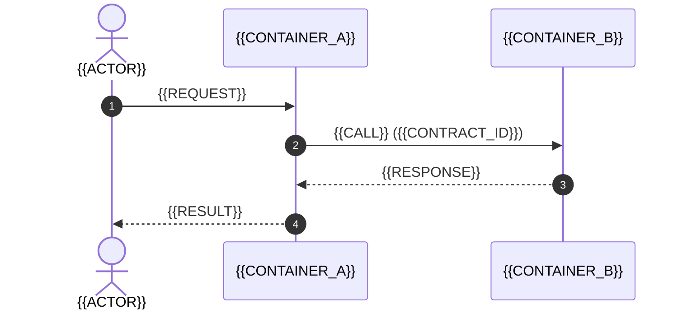

# SCN-{{NNN}} — {{SCENARIO_NAME}}

[← Table of Contents]({{INDEX_PATH}}) · *System Views › Runtime › SCN-{{NNN}}*

## Table of Contents

- [Summary](#summary)
- [Trigger and Preconditions](#trigger-and-preconditions)
- [Participants](#participants)
- [Happy Path](#happy-path)
- [Failure Branches](#failure-branches)
- [What This Scenario Proves](#what-this-scenario-proves)
- [Self-Check](#self-check)
- [Related Docs](#related-docs)

## Summary

One paragraph, in the domain's own words, saying what happens and why anyone
should care. If the summary could describe three other systems, the scenario is
too abstract to be worth a page.

## Trigger and Preconditions

- **Trigger:** {{WHAT_STARTS_IT — a user action, a clock, an inbound event}}
- **Preconditions:** {{STATE_THAT_MUST_HOLD}}
- **Quality scenario exercised:** QS-{{X}} — {{THE_NUMBER_IT_HAS_TO_MEET}}

## Participants

Every participant must already exist as a container in `c2-container.md` or as an
external system in `c1-context.md` (COR-3). A scenario is not the place to
introduce a new component; if one is needed, the container view is wrong.

| Participant | Stable ID | Role in this flow |
|---|---|---|
| {{CONTAINER}} | {{ID}} | {{WHAT_IT_DOES_HERE}} |

## Happy Path

| Step | Actor | Action | Contract / data | Normative timing |
|---|---|---|---|---|
| 1 | {{WHO}} | {{WHAT}} | {{API-x / MSG-x}} | {{timeout, retry budget}} |

## Failure Branches

The failure branches are the reason this page exists. A happy path alone is a
demo script; the architecture is what happens when step 3 times out.

| Branch | What fails | System behaviour | Who observes it | Recorded where |
|---|---|---|---|---|
| F1 | {{FAILURE}} | {{COMPENSATION / RETRY / DEGRADE}} | {{STK / metric}} | {{log key, metric, alert}} |

## What This Scenario Proves

| Claim | Evidence in this page |
|---|---|
| QS-{{X}} is achievable | {{the timing budget in the step table sums to under the target}} |
| The contract set is sufficient for this flow | {{every arrow cites a contract id}} |

## Self-Check

| Claim | How it will be settled |
|---|---|
| Participants exist in the container/context view | VERIFIED-BY-SCRIPT: COR-3 |
| A QS id is cited | VERIFIED-BY-SCRIPT: COR-4 |
| The timing budget actually meets QS-{{X}} | UNVERIFIABLE-AT-PHASE-1: measured once the system exists, by whoever owns testing |
| At least one failure branch is documented | VERIFIED-BY-SCRIPT: section is non-empty |

## Related Docs

- [Scenario Index](00-scenario-index.md)
- [Container View](../c2-container.md)
- [Shared Contracts](../../02-domains/_shared-contracts/00-core/contract-design.md)
