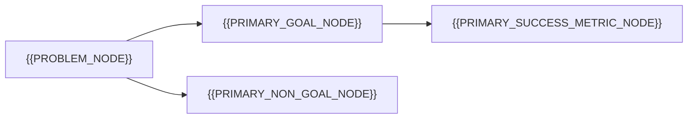

# Goals And Non-Goals

[← Table of Contents]({{INDEX_PATH}})

## Table of Contents

{{TOC_LINKS}}

{{GOALS_SUMMARY}}

## Business Goals

| ID | Goal | Success Metric | Owner | Priority |
|---|---|---|---|---|
{{BUSINESS_GOAL_ROWS}}

## Technical Goals

| ID | Goal | Quality Attribute | Measurement | Linked Requirement |
|---|---|---|---|---|
{{TECHNICAL_GOAL_ROWS}}

## Non-Goals

| ID | Non-Goal | Reason | Risk If Included | Revisit Trigger |
|---|---|---|---|---|
{{NON_GOAL_ROWS}}

## Scope Decision Map

## Self Check

{{SELF_CHECK_NOTE}}
## Assumptions and Open Questions

{{ASSUMPTIONS}}

## Related Docs

{{RELATED_DOC_LINKS}}
