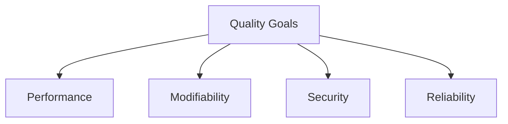

# Quality Attributes — Quantified Non-Functional Requirements

[← Table of Contents]({{INDEX_PATH}}) · *Global Strategy › Strategy › Quality*

## Table of Contents

- [Summary](#summary)
- [Quality Tree](#quality-tree)
- [Quantified Attributes](#quantified-attributes)
- [Quality Scenarios](#quality-scenarios)
- [Assumptions and Open Questions](#assumptions-and-open-questions)
- [Self-Check](#self-check)
- [See Also](#see-also)
- [Related Docs](#related-docs)

## Summary

Unquantified quality goals cannot fail, which is another way of saying they
cannot pass. Every attribute here carries a number and a measurement method, so
the fitness rules in `03-cross-cutting/04-fitness-functions/` have something real
to trace back to.

## Quality Tree

## Quantified Attributes

| ID | Attribute | Target | Measured by | Priority |
|---|---|---|---|---|
| QA-1 | {{ATTRIBUTE}} | {{QUANTIFIED_TARGET}} | {{MEASUREMENT}} | high \| medium \| low |

## Quality Scenarios

Each scenario is the concrete situation the number exists for.

| ID | Source | Stimulus | Environment | Response | Response measure |
|---|---|---|---|---|---|
| QS-1 | {{SOURCE}} | {{STIMULUS}} | {{ENVIRONMENT}} | {{RESPONSE}} | {{MEASURE}} |

## Assumptions and Open Questions

- ASSUMPTION: {{ASSUMPTION}}
- Open question: {{OPEN_QUESTION}}

## Self-Check

| Check | Status |
|---|---|
| Every attribute has a number and a measurement method | {{CHECK_1}} |
| Every FIT rule's `quality_attribute` resolves into this page | {{CHECK_2}} |

## See Also

- {{RELATED_FIT_IDS}}

## Related Docs

- [Architectural Principles](architecture-principles.md)
- [Fitness Functions](../../03-cross-cutting/04-fitness-functions/00-overview.md)
