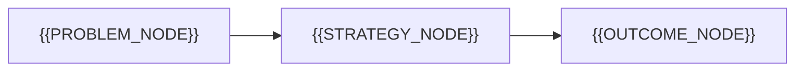

# Solution Strategy

[← Table of Contents]({{INDEX_PATH}})

## Table of Contents

{{TOC_LINKS}}

{{SOLUTION_STRATEGY_SUMMARY}}

## Approach

{{APPROACH_DETAIL}}

## Alternatives

| Option | Strength | Weakness | Decision | Reason |
|---|---|---|---|---|
{{ALTERNATIVE_ROWS}}

## Design Principles

{{DESIGN_PRINCIPLE_ITEMS}}

## Self Check

{{SELF_CHECK_NOTE}}
## Assumptions and Open Questions

{{ASSUMPTIONS}}

## Related Docs

{{RELATED_DOC_LINKS}}
