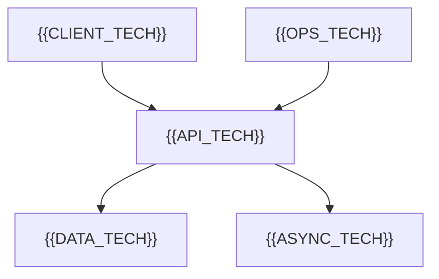

# Technology Selection

[← Table of Contents]({{INDEX_PATH}})

## Table of Contents

{{TOC_LINKS}}

{{TECH_SELECTION_SUMMARY}}

## Selected Stack

| Layer | Technology | Purpose | Why It Fits | Cost/Risk |
|---|---|---|---|---|
{{TECH_STACK_ROWS}}

## Selection Scorecard

| Option | Fit | Complexity | Reliability | Performance | Cost | Decision |
|---|---|---|---|---|---|---|
{{TECH_SCORECARD_ROWS}}

## Technology Map

## Self Check

{{SELF_CHECK_NOTE}}
## Assumptions and Open Questions

{{ASSUMPTIONS}}

## Related Docs

{{RELATED_DOC_LINKS}}
