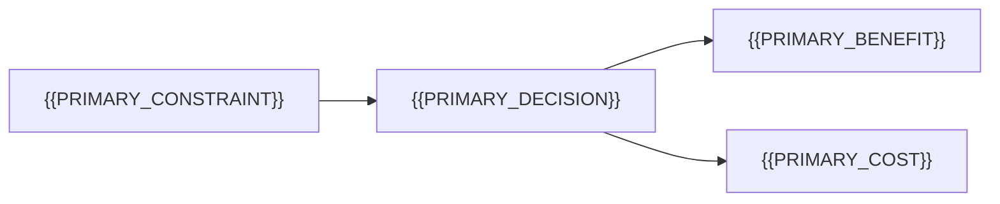

# Tradeoffs And Decisions

[← Table of Contents]({{INDEX_PATH}}) · *Tradeoffs And ADR*

## Table of Contents

{{TOC_LINKS}}

{{ADR_SUMMARY}}

## Decision Records

| ID | Context | Decision | Alternatives | Consequence | Owner |
|---|---|---|---|---|---|
{{DECISION_ROWS}}

## Risks

| ID | Risk | Impact | Likelihood | Mitigation | Signal |
|---|---|---|---|---|---|
{{RISK_ROWS}}

## Decision Map

## Assumptions and Open Questions

{{ASSUMPTIONS}}

## Self-Check

{{SELF_CHECK_NOTE}}

## Related Docs

{{RELATED_DOC_LINKS}}
