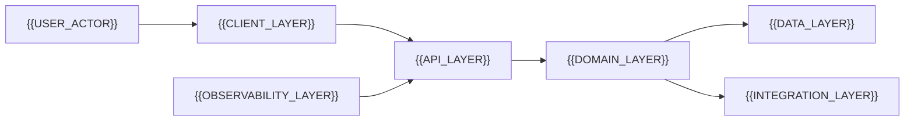

# Architecture

[← Table of Contents]({{INDEX_PATH}})

## Table of Contents

{{TOC_LINKS}}

{{ARCHITECTURE_SUMMARY}}

## High-Level Architecture

| Layer | Responsibility | Technology | Scaling Note |
|---|---|---|---|
{{ARCHITECTURE_LAYER_ROWS}}

## Boundaries

| Boundary | Inside | Outside | Contract |
|---|---|---|---|
{{BOUNDARY_ROWS}}

## Self Check

{{SELF_CHECK_NOTE}}
## Assumptions and Open Questions

{{ASSUMPTIONS}}

## Related Docs

{{RELATED_DOC_LINKS}}
