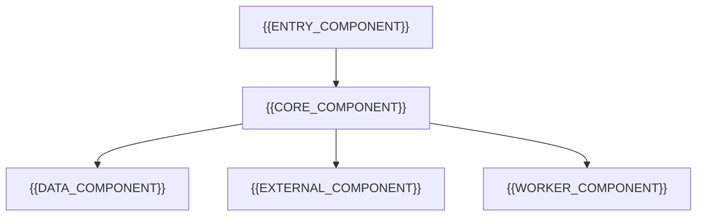

# Component Design

[← Table of Contents]({{INDEX_PATH}})

## Table of Contents

{{TOC_LINKS}}

{{COMPONENT_DESIGN_SUMMARY}}

## Component Dependency Map

See also [mechanism-design.md](mechanism-design.md) for runtime behavior.

| Component | Responsibility | Inputs | Outputs | Dependencies |
|---|---|---|---|---|
{{COMPONENT_ROWS}}

## Ownership And Change Impact

| Component | Owner | Change Risk | Extension Point |
|---|---|---|---|
{{COMPONENT_OWNERSHIP_ROWS}}
## Assumptions and Open Questions

{{ASSUMPTIONS}}

## Self-Check

{{SELF_CHECK_NOTE}}

## Related Docs

{{RELATED_DOC_LINKS}}
