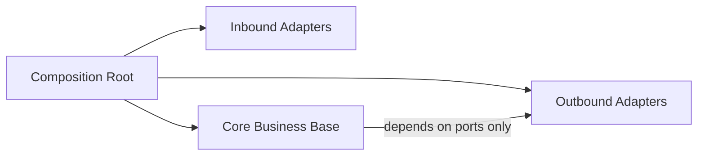

# Composition Root — {{SYSTEM_NAME}}

[← Table of Contents]({{INDEX_PATH}}) · *Global Strategy › Composition Root*

## Table of Contents

- [Summary](#summary)
- [Entry Point](#entry-point)
- [Dependency Wiring Graph](#dependency-wiring-graph)
- [Root Routing](#root-routing)
- [Configuration Precedence](#configuration-precedence)
- [Build and Assembly](#build-and-assembly)
- [Assumptions and Open Questions](#assumptions-and-open-questions)
- [Self-Check](#self-check)
- [See Also](#see-also)
- [Related Docs](#related-docs)

## Summary

The **composition root** is the single place where the application is assembled:
the one entry point that knows about every concrete implementation, wires the
ports to their adapters, mounts the root routes, and resolves configuration. Every
other module stays ignorant of who implements its outbound ports.

This page is **required** whenever any `module_charter` row declares
`module_role: app-lifecycle`. Without it the wiring is implicit, and "who
constructs what" becomes an archaeology exercise across the whole tree.

## Entry Point

| Field | Value |
|---|---|
| Executable / process | {{ENTRY_POINT}} |
| Owning module | {{APP_LIFECYCLE_MODULE}} (`module_role: app-lifecycle`) |
| Startup command | {{STARTUP_COMMAND}} |
| Shutdown contract | {{SHUTDOWN_CONTRACT}} |

## Dependency Wiring Graph

Each row binds one outbound port to exactly one adapter. A port with two
bindings in the same profile is a configuration defect, not a feature.

| Port (stable ID) | Bound adapter | Lifetime | Profile / condition |
|---|---|---|---|
| {{PORT_ID}} | {{ADAPTER}} | singleton \| scoped \| transient | {{PROFILE}} |

## Root Routing

| Route prefix | Handled by | Inbound adapter | Auth |
|---|---|---|---|
| {{ROUTE_PREFIX}} | {{MODULE}} | {{INBOUND_ADAPTER}} | {{AUTH_MODE}} |

## Configuration Precedence

State the resolution order explicitly, highest priority first. Ambiguity here is
the usual root cause of "works locally, fails in staging".

1. {{PRECEDENCE_1}}
2. {{PRECEDENCE_2}}
3. {{PRECEDENCE_3}}

## Build and Assembly

| Concern | Decision |
|---|---|
| Build tool | {{BUILD_TOOL}} |
| Module assembly order | {{ASSEMBLY_ORDER}} |
| Artifact produced | {{ARTIFACT}} |

## Assumptions and Open Questions

- ASSUMPTION: {{ASSUMPTION}}
- Open question: {{OPEN_QUESTION}}

## Self-Check

| Check | Status |
|---|---|
| Every outbound port in the workspace has exactly one binding per profile | {{CHECK_1}} |
| The entry point owner carries `module_role: app-lifecycle` in `registered planning artifact` | {{CHECK_2}} |
| No module other than this one constructs a concrete adapter | {{CHECK_3}} |

## See Also

- {{RELATED_PORT_IDS}}
- {{RELATED_ADR_IDS}}

## Related Docs

- [Architecture](architecture.md)
- [Solution Strategy](02-strategy/solution-strategy.md)
