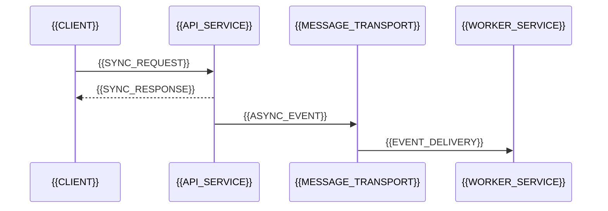

# Contracts And Integrations

[← Table of Contents]({{INDEX_PATH}}) · *Contract Design*

## Table of Contents

{{TOC_LINKS}}

{{CONTRACT_DESIGN_SUMMARY}}

## Interaction Map

## Contract Catalog

| ID | Type | Name | Producer/Caller | Consumer/Handler | Page |
|---|---|---|---|---|---|
{{CONTRACT_CATALOG_ROWS}}

## Error Contract

| Error Code | Meaning | Client Action | Observable Signal |
|---|---|---|---|
{{ERROR_CONTRACT_ROWS}}
## Assumptions and Open Questions

{{ASSUMPTIONS}}

## Self-Check

{{SELF_CHECK_NOTE}}

## Related Docs

{{RELATED_DOC_LINKS}}
