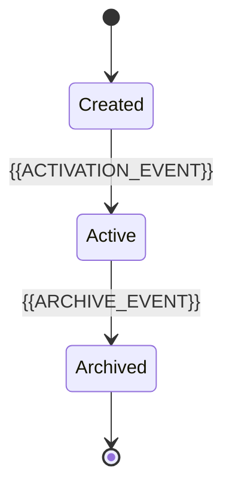

# Data Design

[← Table of Contents]({{INDEX_PATH}})

## Table of Contents

{{TOC_LINKS}}

{{DATA_DESIGN_SUMMARY}}

## Domain Data Map

```mermaid
erDiagram
    {{ENTITY_A}} ||--o{ {{ENTITY_B}} : "{{RELATIONSHIP_NAME}}"
    {{ENTITY_A}} {
      string id
      string name
      datetime created_at
    }
    {{ENTITY_B}} {
      string id
      string status
      datetime updated_at
    }
```

| Data Area | Owner | Store | Consistency | Retention |
|---|---|---|---|---|
{{DATA_AREA_ROWS}}

## Data Lifecycle



| State | Entry Condition | Allowed Transition | Data Rule |
|---|---|---|---|
{{DATA_LIFECYCLE_ROWS}}
## Assumptions and Open Questions

{{ASSUMPTIONS}}

## Self-Check

{{SELF_CHECK_NOTE}}

## Related Docs

{{RELATED_DOC_LINKS}}
