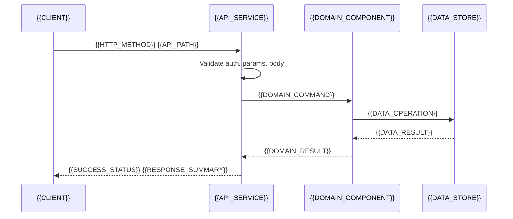

# {{API_NAME}}

[← Table of Contents]({{INDEX_PATH}}) · *API Contract*

## Table of Contents

{{TOC_LINKS}}

## Summary

{{API_PURPOSE}}

## Core Description & Mechanisms

{{PLACEHOLDER: Provide a deep technical explanation of the API's inner workings. Do not list properties. Explain the caching strategy, rate-limiting, database interaction patterns, idempotency handling, and how authorization is validated. This must be a rich narrative paragraph, not a list.}}

{{HTTP_METHOD}} {{API_PATH}} {{API_VERSION}}

## Request Sequence



## Detailed Tables & Data Contracts

### Parameters

| Location | Name | Type | Required | Validation | Description |
|---|---|---|---|---|---|
{{API_PARAMETER_ROWS}}

### Request Body

```
{{REQUEST_BODY_JSON}}
```

### Responses

| Status | Meaning | Body | Client Action |
|---|---|---|---|
{{API_RESPONSE_ROWS}}

### Success Example

```
{{SUCCESS_RESPONSE_JSON}}
```

### Error Example

```
{{ERROR_RESPONSE_JSON}}
```

## Operational Rules

| Field | Value |
|---|---|
| Auth | {{AUTH_RULE}} |
| Permission | {{PERMISSION_RULE}} |
| Rate Limit | {{RATE_LIMIT_RULE}} |
| Idempotency | {{IDEMPOTENCY_RULE}} |
| Pagination | {{PAGINATION_RULE}} |

## Assumptions and Open Questions

{{ASSUMPTIONS}}

## Self-Check

{{SELF_CHECK_NOTE}}

## Related Docs

{{RELATED_DOC_LINKS}}
