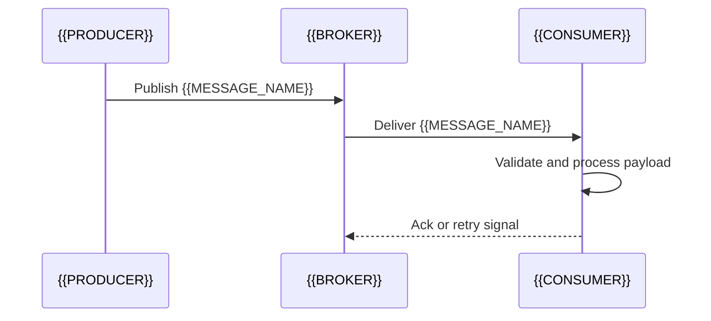

# {{MESSAGE_NAME}}

[← Table of Contents]({{INDEX_PATH}}) · *Message Contract*

## Table of Contents

{{TOC_LINKS}}

## Summary

{{MESSAGE_PURPOSE}}

## Core Description & Mechanisms

{{PLACEHOLDER: Provide a deep technical explanation of this message's role in the event-driven architecture. Explain the exact conditions that trigger this message, the expected side-effects on the consumer side, how idempotency is guaranteed, and how poison pills are handled. This must be a narrative paragraph, not a list.}}

{{TRANSPORT}} {{TOPIC_OR_QUEUE}} {{DELIVERY_SEMANTICS}}

## Message Flow



## Detailed Tables & Data Contracts

### Payload Schema

```
{{MESSAGE_PAYLOAD_JSON}}
```

| Field | Type | Required | Producer Rule | Consumer Rule |
|---|---|---|---|---|
{{MESSAGE_FIELD_ROWS}}

### Delivery And Failure Handling

| Field | Value |
|---|---|
| Ordering | {{ORDERING_RULE}} |
| Retry | {{RETRY_RULE}} |
| Dead Letter | {{DEAD_LETTER_RULE}} |
| Deduplication | {{DEDUPLICATION_RULE}} |
| Replay | {{REPLAY_RULE}} |
| Observability | {{MESSAGE_OBSERVABILITY_SIGNALS}} |

## Assumptions and Open Questions

{{ASSUMPTIONS}}

## Self-Check

{{SELF_CHECK_NOTE}}

## Related Docs

{{RELATED_DOC_LINKS}}
