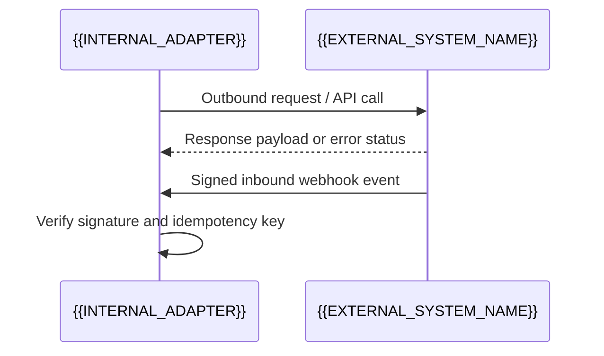

# {{EXTERNAL_SYSTEM_NAME}}

[← Table of Contents]({{INDEX_PATH}}) · *External Integration Contract*

## Table of Contents

{{TOC_LINKS}}

## Summary

{{EXTERNAL_SYSTEM_PURPOSE}}

## Core Description & Anti-Corruption Boundary

{{PLACEHOLDER: Provide a detailed technical specification of the external system boundary, authentication mechanism, rate limits, webhook verification, and anti-corruption translation rules between external payloads and internal canonical types.}}

## Integration Sequence

## Detailed Tables & Endpoint Contracts

| Endpoint / Webhook | Protocol & Auth | Timeout & Retry Rule | Failure Mapping |
|---|---|---|---|
{{EXTERNAL_CONTRACT_ROWS}}

## Assumptions and Open Questions

{{ASSUMPTIONS}}

## Self-Check

{{SELF_CHECK_NOTE}}

## Related Docs

{{RELATED_DOC_LINKS}}
