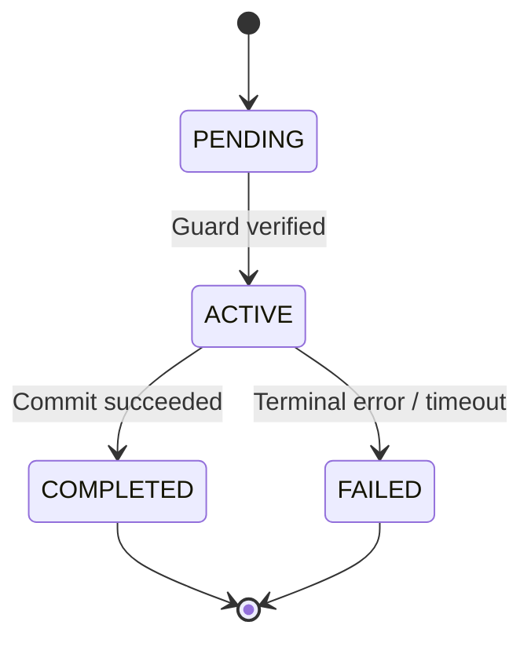

# {{STATE_MACHINE_NAME}}

[← Table of Contents]({{INDEX_PATH}}) · *Cross-Context State Machine Contract*

## Table of Contents

{{TOC_LINKS}}

## Summary

{{STATE_MACHINE_PURPOSE}}

## Lifecycle States & Transition Rules

{{PLACEHOLDER: Describe the canonical lifecycle states, transition triggers, guard predicates, optimistic locking / lease fencing rules, and compensating recovery actions when a transition fails.}}

## State Diagram

## Transition Guard Matrix

| From State | To State | Trigger Event | Guard Predicate | Side Effects & Telemetry |
|---|---|---|---|---|
{{STATE_TRANSITION_ROWS}}

## Assumptions and Open Questions

{{ASSUMPTIONS}}

## Self-Check

{{SELF_CHECK_NOTE}}

## Related Docs

{{RELATED_DOC_LINKS}}
