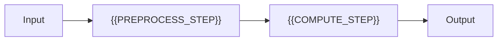

# Algorithm And Complexity

[← Table of Contents]({{INDEX_PATH}}) · *Academic Research Module*

## Table of Contents

{{TOC_LINKS}}

{{ALGORITHM_COMPLEXITY_SUMMARY}}

## Algorithm Flow

## Complexity Analysis

| Step | Time | Space | Assumption | Risk |
|---|---|---|---|---|
{{COMPLEXITY_ROWS}}
## Assumptions and Open Questions

{{ASSUMPTIONS}}

## Self-Check

{{SELF_CHECK_NOTE}}

## Related Docs

{{RELATED_DOC_LINKS}}
