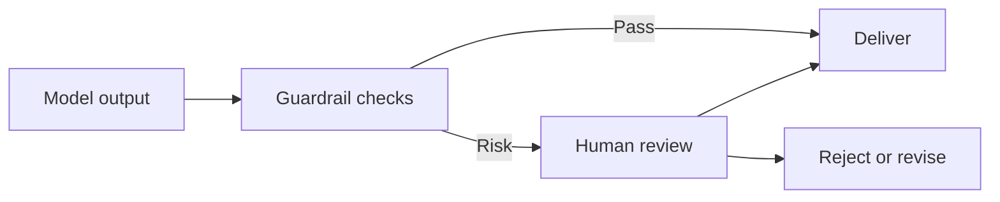

# Guardrails Human Review

[← Table of Contents]({{INDEX_PATH}}) · *AI ML RAG Module*

## Table of Contents

{{TOC_LINKS}}

{{GUARDRAILS_REVIEW_SUMMARY}}

## Review Flow

## Guardrail Catalog

| Guardrail | Risk Reduced | Action | Review Owner | Signal |
|---|---|---|---|---|
{{GUARDRAIL_ROWS}}
## Assumptions and Open Questions

{{ASSUMPTIONS}}

## Self-Check

{{SELF_CHECK_NOTE}}

## Related Docs

{{RELATED_DOC_LINKS}}
