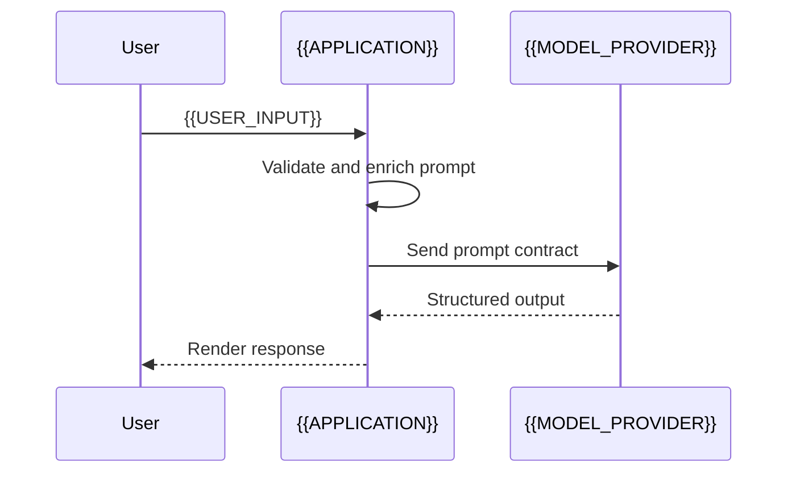

# Prompt Input Contract

[← Table of Contents]({{INDEX_PATH}}) · *AI ML RAG Module*

## Table of Contents

{{TOC_LINKS}}

{{PROMPT_INPUT_SUMMARY}}

## Prompt Flow



## Input Schema

```
{{PROMPT_INPUT_JSON}}
```

| Field | Type | Required | Validation | Purpose |
|---|---|---|---|---|
{{PROMPT_INPUT_FIELD_ROWS}}
## Assumptions and Open Questions

{{ASSUMPTIONS}}

## Self-Check

{{SELF_CHECK_NOTE}}

## Related Docs

{{RELATED_DOC_LINKS}}
