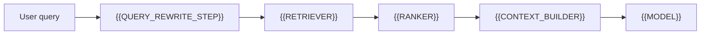

# Retrieval And Ranking Pipeline

[← Table of Contents]({{INDEX_PATH}}) · *AI ML RAG Module*

## Table of Contents

{{TOC_LINKS}}

{{RETRIEVAL_RANKING_SUMMARY}}

## Retrieval Pipeline

## Retrieval Controls

| Step | Input | Output | Quality Rule | Failure Handling |
|---|---|---|---|---|
{{RETRIEVAL_STEP_ROWS}}
## Assumptions and Open Questions

{{ASSUMPTIONS}}

## Self-Check

{{SELF_CHECK_NOTE}}

## Related Docs

{{RELATED_DOC_LINKS}}
