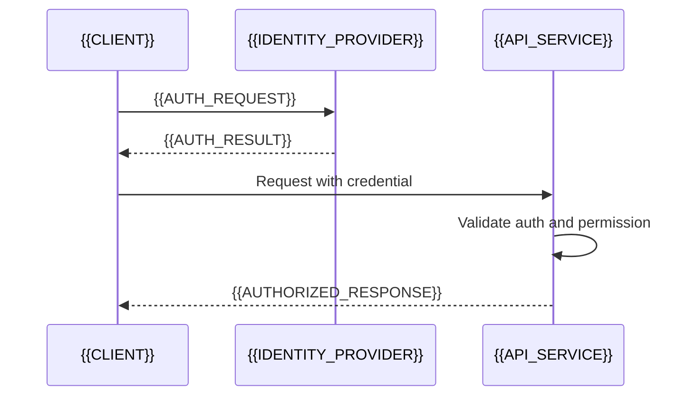

# Authentication And Authorization Flow

[← Table of Contents]({{INDEX_PATH}}) · *Backend API Module*

## Table of Contents

{{TOC_LINKS}}

{{API_AUTH_FLOW_SUMMARY}}

## Auth Sequence

## Permission Rules

| Role/Client | Scope/Permission | Allowed APIs | Denied Behavior |
|---|---|---|---|
{{API_PERMISSION_ROWS}}
## Assumptions and Open Questions

{{ASSUMPTIONS}}

## Self-Check

{{SELF_CHECK_NOTE}}

## Related Docs

{{RELATED_DOC_LINKS}}
