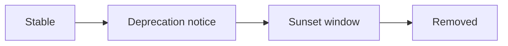

# Versioning And Deprecation

[← Table of Contents]({{INDEX_PATH}}) · *Backend API Module*

## Table of Contents

{{TOC_LINKS}}

{{API_VERSIONING_SUMMARY}}

## Version Policy

| Version | Status | Supported Until | Breaking Changes | Migration Path |
|---|---|---|---|---|
{{API_VERSION_ROWS}}

## Deprecation Flow

## Assumptions and Open Questions

{{ASSUMPTIONS}}

## Self-Check

{{SELF_CHECK_NOTE}}

## Related Docs

{{RELATED_DOC_LINKS}}
