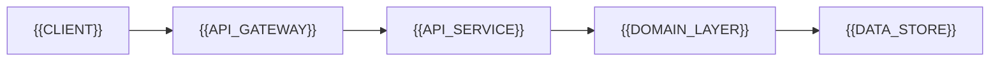

# Backend API Overview

[← Table of Contents]({{INDEX_PATH}}) · *Backend API Module*

## Table of Contents

{{TOC_LINKS}}

{{BACKEND_API_SUMMARY}}

## API Platform Scope

| Area | Decision | Reason | Linked Artifact |
|---|---|---|---|
{{BACKEND_API_SCOPE_ROWS}}

## Backend Responsibility Map

## Assumptions and Open Questions

{{ASSUMPTIONS}}

## Self-Check

{{SELF_CHECK_NOTE}}

## Related Docs

{{RELATED_DOC_LINKS}}
