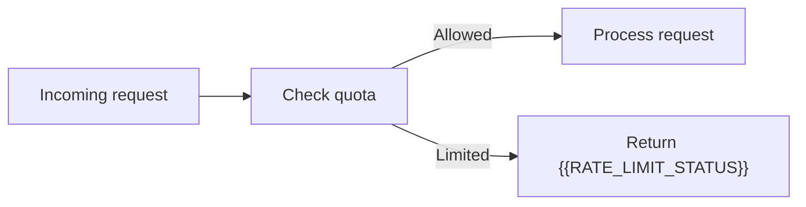

# Rate Limit Policy

[← Table of Contents]({{INDEX_PATH}}) · *Backend API Module*

## Table of Contents

{{TOC_LINKS}}

{{RATE_LIMIT_SUMMARY}}

## Limit Matrix

| Consumer | Endpoint/Group | Limit | Window | Burst | Response |
|---|---|---|---|---|---|
{{RATE_LIMIT_ROWS}}

## Throttle Behavior

## Assumptions and Open Questions

{{ASSUMPTIONS}}

## Self-Check

{{SELF_CHECK_NOTE}}

## Related Docs

{{RELATED_DOC_LINKS}}
