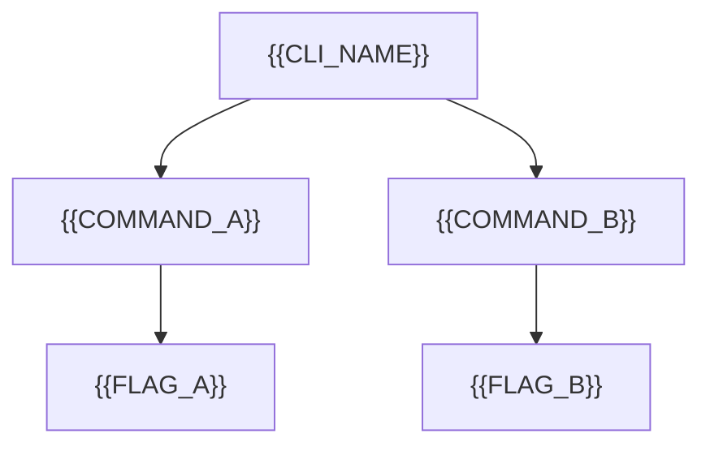

# Command Tree

[← Table of Contents]({{INDEX_PATH}}) · *CLI Tool Module*

## Table of Contents

{{TOC_LINKS}}

{{COMMAND_TREE_SUMMARY}}

## Command Structure

## Command Catalog

| Command | Purpose | Args | Flags | Output |
|---|---|---|---|---|
{{COMMAND_CATALOG_ROWS}}
## Assumptions and Open Questions

{{ASSUMPTIONS}}

## Self-Check

{{SELF_CHECK_NOTE}}

## Related Docs

{{RELATED_DOC_LINKS}}
