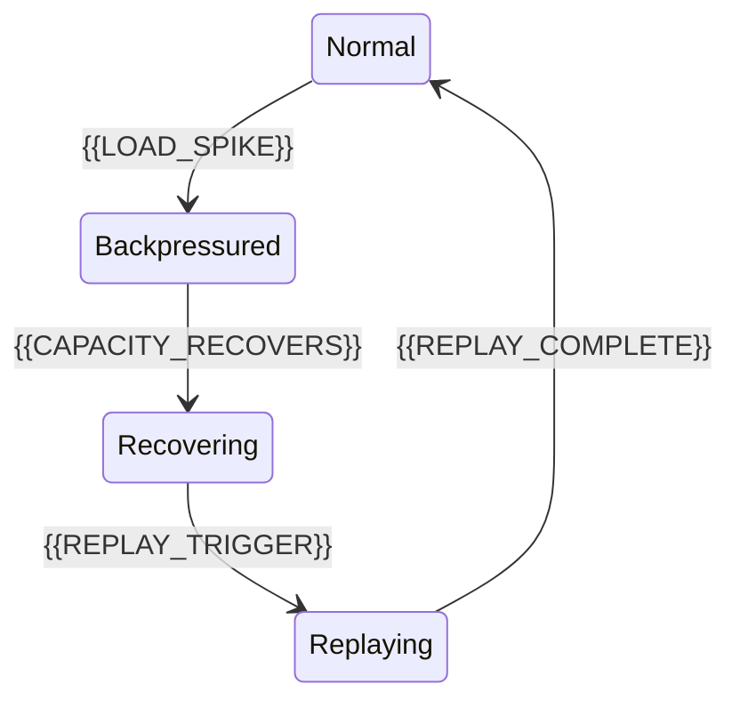

# Backpressure And Replay Policy

[← Table of Contents]({{INDEX_PATH}}) · *Data Pipeline Module*

## Table of Contents

{{TOC_LINKS}}

{{BACKPRESSURE_REPLAY_SUMMARY}}

## Processing States

## Policy Matrix

| Condition | Action | Replay Source | Limit | Signal |
|---|---|---|---|---|
{{BACKPRESSURE_REPLAY_ROWS}}
## Assumptions and Open Questions

{{ASSUMPTIONS}}

## Self-Check

{{SELF_CHECK_NOTE}}

## Related Docs

{{RELATED_DOC_LINKS}}
