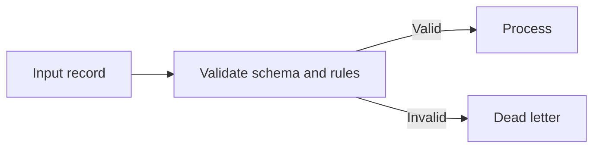

# Data Validation And Dead Letter Handling

[← Table of Contents]({{INDEX_PATH}}) · *Data Pipeline Module*

## Table of Contents

{{TOC_LINKS}}

{{DATA_VALIDATION_DLQ_SUMMARY}}

## Validation Flow

## Validation Rules

| Rule | Field/Data | Failure Reason | DLQ Payload | Recovery |
|---|---|---|---|---|
{{DATA_VALIDATION_ROWS}}
## Assumptions and Open Questions

{{ASSUMPTIONS}}

## Self-Check

{{SELF_CHECK_NOTE}}

## Related Docs

{{RELATED_DOC_LINKS}}
