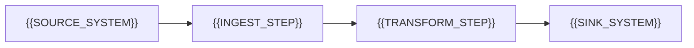

# Source Sink Map

[← Table of Contents]({{INDEX_PATH}}) · *Data Pipeline Module*

## Table of Contents

{{TOC_LINKS}}

{{SOURCE_SINK_SUMMARY}}

## Data Movement

## Source Sink Catalog

| Source | Sink | Data Contract | Frequency | Failure Handling |
|---|---|---|---|---|
{{SOURCE_SINK_ROWS}}
## Assumptions and Open Questions

{{ASSUMPTIONS}}

## Self-Check

{{SELF_CHECK_NOTE}}

## Related Docs

{{RELATED_DOC_LINKS}}
