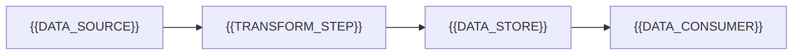

# Data Quality And Lineage

[← Table of Contents]({{INDEX_PATH}}) · *Data Platform Module*

## Table of Contents

{{TOC_LINKS}}

{{DATA_QUALITY_LINEAGE_SUMMARY}}

## Lineage Map

## Quality Rules

| Rule | Dataset | Check | Failure Action | Owner |
|---|---|---|---|---|
{{DATA_QUALITY_ROWS}}
## Assumptions and Open Questions

{{ASSUMPTIONS}}

## Self-Check

{{SELF_CHECK_NOTE}}

## Related Docs

{{RELATED_DOC_LINKS}}
