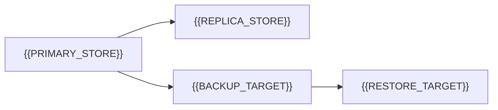

# Replication Partitioning Backup Restore

[← Table of Contents]({{INDEX_PATH}}) · *Data Platform Module*

## Table of Contents

{{TOC_LINKS}}

{{REPLICATION_BACKUP_SUMMARY}}

## Data Resilience Topology

## Resilience Policy

| Area | Strategy | RPO | RTO | Verification |
|---|---|---|---|---|
{{DATA_RESILIENCE_ROWS}}
## Assumptions and Open Questions

{{ASSUMPTIONS}}

## Self-Check

{{SELF_CHECK_NOTE}}

## Related Docs

{{RELATED_DOC_LINKS}}
