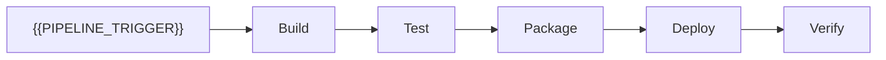

# CI/CD Pipeline

[← Table of Contents]({{INDEX_PATH}}) · *DevOps Infrastructure Module*

## Table of Contents

{{TOC_LINKS}}

{{CICD_PIPELINE_SUMMARY}}

## Pipeline Flow

## Job Catalog

| Stage | Job | Input | Output | Failure Action |
|---|---|---|---|---|
{{CICD_JOB_ROWS}}
## Assumptions and Open Questions

{{ASSUMPTIONS}}

## Self-Check

{{SELF_CHECK_NOTE}}

## Related Docs

{{RELATED_DOC_LINKS}}
