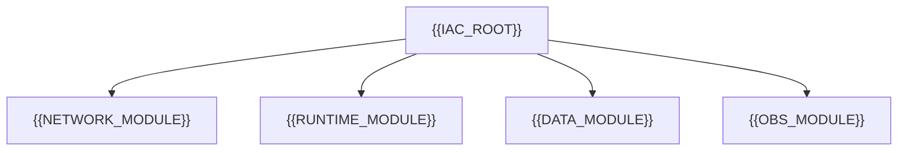

# Infrastructure As Code Design

[← Table of Contents]({{INDEX_PATH}}) · *DevOps Infrastructure Module*

## Table of Contents

{{TOC_LINKS}}

{{IAC_DESIGN_SUMMARY}}

## IaC Module Map

## Variable And Output Contract

| Name | Type | Direction | Purpose | Sensitive |
|---|---|---|---|---|
{{IAC_VARIABLE_OUTPUT_ROWS}}
## Assumptions and Open Questions

{{ASSUMPTIONS}}

## Self-Check

{{SELF_CHECK_NOTE}}

## Related Docs

{{RELATED_DOC_LINKS}}
