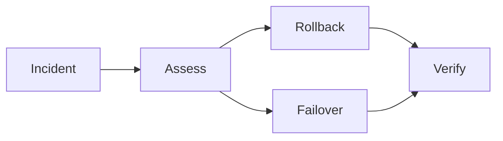

# Release Rollback Disaster Recovery

[← Table of Contents]({{INDEX_PATH}}) · *DevOps Infrastructure Module*

## Table of Contents

{{TOC_LINKS}}

{{RELEASE_ROLLBACK_DR_SUMMARY}}

## Recovery Flow

## Recovery Policy

| Scenario | Trigger | Action | RTO | RPO |
|---|---|---|---|---|
{{RECOVERY_POLICY_ROWS}}
## Assumptions and Open Questions

{{ASSUMPTIONS}}

## Self-Check

{{SELF_CHECK_NOTE}}

## Related Docs

{{RELATED_DOC_LINKS}}
