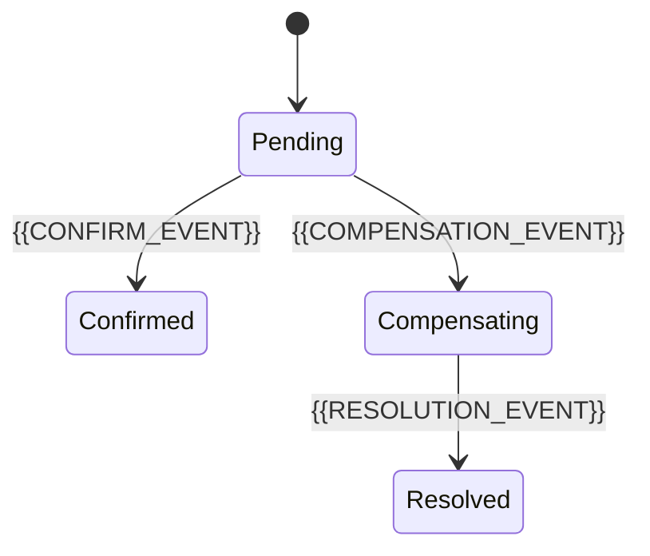

# Consistency Model

[← Table of Contents]({{INDEX_PATH}}) · *Distributed System Module*

## Table of Contents

{{TOC_LINKS}}

{{CONSISTENCY_MODEL_SUMMARY}}

## Consistency Decisions

| Data/Workflow | Consistency Level | Reason | Compensation | User Impact |
|---|---|---|---|---|
{{CONSISTENCY_ROWS}}

## State Convergence

## Assumptions and Open Questions

{{ASSUMPTIONS}}

## Self-Check

{{SELF_CHECK_NOTE}}

## Related Docs

{{RELATED_DOC_LINKS}}
