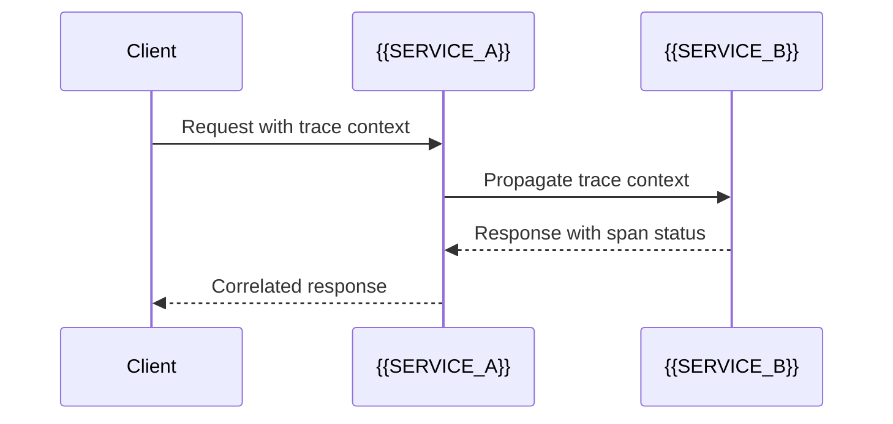

# Distributed Tracing And Failure Scenarios

[← Table of Contents]({{INDEX_PATH}}) · *Distributed System Module*

## Table of Contents

{{TOC_LINKS}}

{{TRACING_FAILURE_SUMMARY}}

## Trace Flow

## Failure Scenario Catalog

| Scenario | Trigger | Expected Behavior | Trace/Metric | Runbook |
|---|---|---|---|---|
{{FAILURE_SCENARIO_ROWS}}
## Assumptions and Open Questions

{{ASSUMPTIONS}}

## Self-Check

{{SELF_CHECK_NOTE}}

## Related Docs

{{RELATED_DOC_LINKS}}
