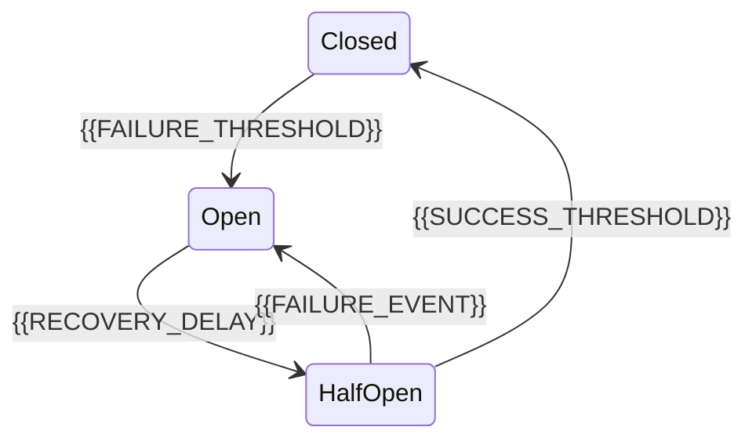

# Fault Tolerance And Circuit Breaker

[← Table of Contents]({{INDEX_PATH}}) · *Distributed System Module*

## Table of Contents

{{TOC_LINKS}}

{{FAULT_TOLERANCE_SUMMARY}}

## Circuit Breaker Lifecycle

## Failure Handling

| Dependency | Failure Mode | Fallback | User Impact | Alert |
|---|---|---|---|---|
{{FAULT_TOLERANCE_ROWS}}
## Assumptions and Open Questions

{{ASSUMPTIONS}}

## Self-Check

{{SELF_CHECK_NOTE}}

## Related Docs

{{RELATED_DOC_LINKS}}
