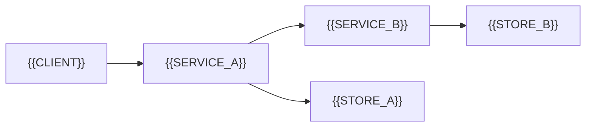

# Service Topology

[← Table of Contents]({{INDEX_PATH}}) · *Distributed System Module*

## Table of Contents

{{TOC_LINKS}}

{{SERVICE_TOPOLOGY_SUMMARY}}

## Topology Diagram

## Dependency Matrix

| Caller | Callee | Protocol | SLO | Fallback |
|---|---|---|---|---|
{{SERVICE_DEPENDENCY_ROWS}}
## Assumptions and Open Questions

{{ASSUMPTIONS}}

## Self-Check

{{SELF_CHECK_NOTE}}

## Related Docs

{{RELATED_DOC_LINKS}}
