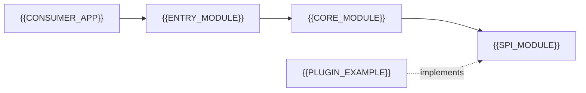

# Framework / Library Overview

[← Table of Contents]({{INDEX_PATH}}) · *Framework-Library Module — Deep-Nested*

## Table of Contents

- [Artifact Profile](#artifact-profile)
- [Consumer Experience Goals](#consumer-experience-goals)
- [Module Landscape](#module-landscape)
- [Bounded-Context Slots](#bounded-context-slots)
- [Assumptions and Open Questions](#assumptions-and-open-questions)
- [Self-Check](#self-check)
- [Related Docs](#related-docs)

{{FRAMEWORK_OVERVIEW_SUMMARY}}

## Artifact Profile

| Field | Value |
|---|---|
| Artifact kind | {{ARTIFACT_KIND}} (framework / library / SDK / starter / plugin) |
| Target runtime / platform | {{TARGET_RUNTIME}} |
| Target consumers | {{TARGET_CONSUMERS}} |
| Distribution channel | {{DISTRIBUTION_CHANNEL}} |
| Naming convention | {{NAMING_CONVENTION}} (e.g. `acme-spring-boot-starter`: third-party starters put the group name first; `spring-boot-starter-*` is reserved for official Spring starters) |
| License | {{LICENSE}} |

## Consumer Experience Goals

| Goal | Metric | Target |
|---|---|---|
{{DX_GOAL_ROWS}}

## Module Landscape

| Module | Purpose | Consumed By |
|---|---|---|
{{MODULE_ROWS}}

## Bounded-Context Slots

| Slot | Contents |
|---|---|
| [`01-configuration/`](../01-configuration/) | Auto-configuration + conditional matrix |
| [`02-core-engine/`](../02-core-engine/) | Chain-of-Responsibility, Strategy, Context holders |
| [`03-extension-points/`](../03-extension-points/) | Fluid-DSL Builder, SPI contracts, customizers |
| [`04-diagrams-specs/`](../04-diagrams-specs/) | Class + sequence diagrams |
| [`05-classpath-dependencies/`](../05-classpath-dependencies/) | BOM, exclusions, packaging, semver |

## Assumptions and Open Questions

{{ASSUMPTIONS}}

## Self-Check

{{SELF_CHECK_NOTE}}

## Related Docs

- [Fluid-DSL Configurer](../03-extension-points/security-configurer-dsl.md)
- [Core Engine Class Diagram](../04-diagrams-specs/core-engine-class-diagram.md)
- [Auto-Configuration](../01-configuration/auto-configuration.md)
- [Dependency Management](../05-classpath-dependencies/dependency-management.md)
{{RELATED_DOC_LINKS}}
