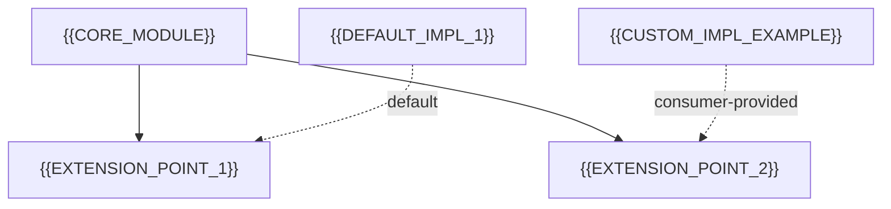

# Extension Points / SPI

[← Table of Contents]({{INDEX_PATH}}) · *Framework-Library / Extension Points*

## Table of Contents

- [Summary](#summary)
- [1. Extension Point Map](#1-extension-point-map)
- [2. Extension Points](#2-extension-points)
- [3. Discovery and Activation](#3-discovery-and-activation)
- [4. Contract Guarantees for Implementors](#4-contract-guarantees-for-implementors)
- [5. Assumptions and Open Questions](#5-assumptions-and-open-questions)
- [6. Self-Check](#6-self-check)
- [7. Related Docs](#7-related-docs)

{{SPI_SUMMARY}}

## 1. Extension Point Map

## 2. Extension Points

| Extension point | Kind | Contract | Default implementation | Override mechanism |
|---|---|---|---|---|
{{EXTENSION_POINT_ROWS}}

Kinds: interface/SPI, callback/hook, event listener, template method, configuration property, auto-configuration condition.

## 3. Discovery and Activation

| Mechanism | When it applies | Notes |
|---|---|---|
{{ACTIVATION_ROWS}}

Examples: `ServiceLoader`/`META-INF/services`, Spring `AutoConfiguration.imports` + `@ConditionalOnMissingBean`, plugin registry, explicit registration API.

## 4. Contract Guarantees for Implementors

- {{GUARANTEE_1}}
- {{GUARANTEE_2}}
{{GUARANTEE_EXTRA}}

## 5. Assumptions and Open Questions

{{ASSUMPTIONS}}

## 6. Self-Check

{{SELF_CHECK_NOTE}}

## 7. Related Docs

- [Public API Surface](public-api-surface.md)
- [Customizer Interfaces](customizer-interfaces.md)
- [Custom Provider Integration](custom-provider-integration.md)
- [Fluid-DSL Configurer](security-configurer-dsl.md)
{{RELATED_DOC_LINKS}}
