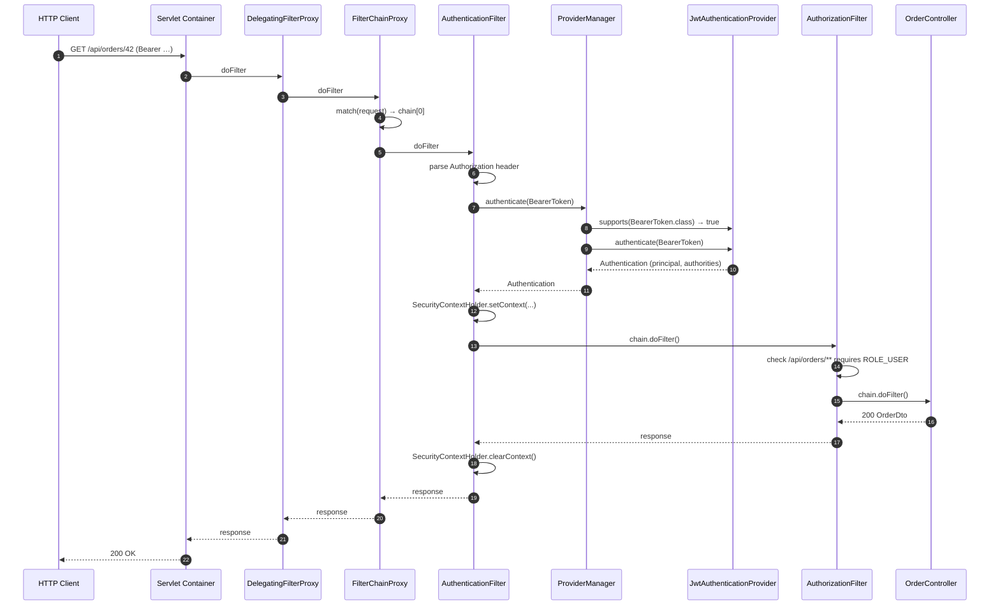

# Authentication — Sequence Diagram

[← Table of Contents]({{INDEX_PATH}}) · *Framework-Library / Diagrams & Specs*

## Table of Contents

- [Summary](#summary)
- [1. Scenario](#1-scenario)
- [2. Diagram](#2-diagram)
- [3. Notable Boundary Behaviours](#3-notable-boundary-behaviours)
- [4. Related Docs](#4-related-docs)

## Summary

Full request flow of an authenticated HTTP request: entry into the Servlet container, dispatch through the framework's filter chain, credential extraction, provider-strategy resolution, and downstream business-handler invocation. This sequence is the *canonical* success path — deviations (401, 403, provider-not-found) are documented in adjacent flow files.

## 1. Scenario

Consumer calls `GET /api/orders/42` with `Authorization: Bearer eyJhbGciOi...` on an application that has enabled the framework's JWT provider through the DSL.

## 2. Diagram

## 3. Notable Boundary Behaviours

| Step | Behaviour | Rationale |
|---|---|---|
| Header parse | Missing `Authorization` → `AuthF` continues without setting context; downstream `AuthzF` decides `401` | Anonymous endpoints must still be reachable |
| Provider resolution | No matching `supports()` → `ProviderNotFoundException`, `AuthF` maps to `401` | Silent skip would leak unsigned tokens |
| Context clear | Executed in `finally` block | Prevents leak between requests on reused worker threads |
| Authorization | Uses `Authentication.getAuthorities()` — no re-authentication | Provider state is trusted for the duration of the request |

## 4. Related Docs

- [Filter Chain (Chain of Responsibility)](../02-core-engine/filter-chain-responsibility.md)
- [Authentication Manager (Strategy)](../02-core-engine/authentication-manager-strategy.md)
- [Context ThreadLocal Holder](../02-core-engine/context-threadlocal-holder.md)
- [Core Engine Class Diagram](core-engine-class-diagram.md)
