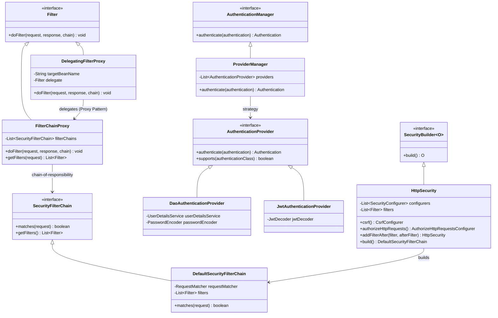

# Core Engine — Class Diagram

[← Table of Contents]({{INDEX_PATH}}) · *Framework-Library / Diagrams & Specs*

## Table of Contents

- [Summary](#summary)
- [1. Patterns Overlay](#1-patterns-overlay)
- [2. Diagram](#2-diagram)
- [3. Reading the Diagram](#3-reading-the-diagram)
- [4. Related Docs](#4-related-docs)

## Summary

Single-view class diagram of the framework's runtime engine. Four cooperating patterns are colour-coded: **Proxy** (dispatcher → chain), **Chain of Responsibility** (chain → filters), **Strategy** (manager → providers), **Builder** (DSL → filter chain). If a class in the code base does not appear here, either the diagram is stale or the class is `internal`.

## 1. Patterns Overlay

| Pattern | Roles | Class(es) |
|---|---|---|
| Proxy | Wrap Servlet Container filter with Spring bean | `DelegatingFilterProxy` → `FilterChainProxy` |
| Chain of Responsibility | Ordered filter execution | `FilterChainProxy` → `SecurityFilterChain` → `Filter[]` |
| Strategy | Pluggable authentication providers | `ProviderManager` → `AuthenticationProvider[]` |
| Builder | Fluid-DSL construction of chains | `HttpSecurity` → `DefaultSecurityFilterChain` |

## 2. Diagram

## 3. Reading the Diagram

- Follow the arrows top-down for **runtime** flow: Servlet → Proxy → Chain → Filter → (per filter) AuthenticationManager → Provider.
- Follow the arrows right-to-left for **construction** flow: Builder (`HttpSecurity`) → `DefaultSecurityFilterChain` → `FilterChainProxy`.
- Classes without stereotypes are concrete framework types; `<<interface>>` marks the extension seams a third party implements.

## 4. Related Docs

- [Filter Chain (Chain of Responsibility)](../02-core-engine/filter-chain-responsibility.md)
- [Authentication Manager (Strategy)](../02-core-engine/authentication-manager-strategy.md)
- [Fluid-DSL Configurer (Builder)](../03-extension-points/security-configurer-dsl.md)
- [Authentication Sequence](authentication-sequence.md)
