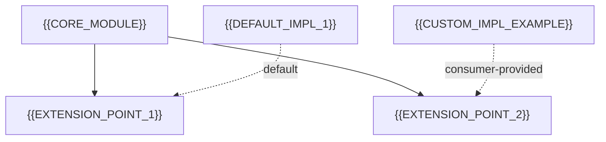

# Extension Points / SPI

[← Table of Contents]({{INDEX_PATH}}) · *Framework-Library Module*

## Table of Contents

{{TOC_LINKS}}

{{SPI_SUMMARY}}

## Extension Point Map

## Extension Points

| Extension point | Kind | Contract | Default implementation | Override mechanism |
|---|---|---|---|---|
{{EXTENSION_POINT_ROWS}}

Kinds: interface/SPI, callback/hook, event listener, template method, configuration property, auto-configuration condition.

## Discovery and Activation

| Mechanism | When it applies | Notes |
|---|---|---|
{{ACTIVATION_ROWS}}

Examples: `ServiceLoader`/`META-INF/services`, Spring `AutoConfiguration.imports` + `@ConditionalOnMissingBean`, plugin registry, explicit registration API.

## Contract Guarantees for Implementors

- {{GUARANTEE_1}}
- {{GUARANTEE_2}}
{{GUARANTEE_EXTRA}}

## Assumptions and Open Questions

{{ASSUMPTIONS}}

## Self-Check

{{SELF_CHECK_NOTE}}

## Related Docs

- [Public API Surface](public-api-surface.md)
- [Plugin & Module Architecture](plugin-module-architecture.md)
{{RELATED_DOC_LINKS}}
