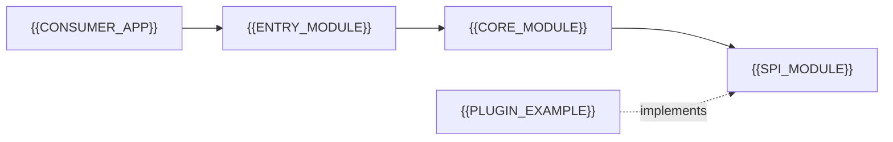

# Framework / Library Overview

[← Table of Contents]({{INDEX_PATH}}) · *Framework-Library Module*

## Table of Contents

{{TOC_LINKS}}

{{FRAMEWORK_OVERVIEW_SUMMARY}}

## Artifact Profile

| Field | Value |
|---|---|
| Artifact kind | {{ARTIFACT_KIND}} (framework / library / SDK / starter / plugin) |
| Target runtime / platform | {{TARGET_RUNTIME}} |
| Target consumers | {{TARGET_CONSUMERS}} |
| Distribution channel | {{DISTRIBUTION_CHANNEL}} |
| Naming convention | {{NAMING_CONVENTION}} (e.g. `acme-spring-boot-starter`: third-party starters put the group name first, `spring-boot-starter-*` is reserved for official Spring starters) |
| License | {{LICENSE}} |

## Consumer Experience Goals

| Goal | Metric | Target |
|---|---|---|
{{DX_GOAL_ROWS}}

## Module Landscape

| Module | Purpose | Consumed By |
|---|---|---|
{{MODULE_ROWS}}

## Assumptions and Open Questions

{{ASSUMPTIONS}}

## Self-Check

{{SELF_CHECK_NOTE}}

## Related Docs

- [Public API Surface](public-api-surface.md)
- [Extension Points / SPI](extension-points-spi.md)
- [Plugin & Module Architecture](plugin-module-architecture.md)
- [Versioning & Compatibility](versioning-compatibility.md)
- [Packaging & Distribution](packaging-distribution.md)
- [Configuration Contract](configuration-contract.md)
{{RELATED_DOC_LINKS}}
