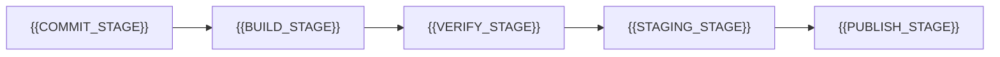

# Packaging & Distribution

[← Table of Contents]({{INDEX_PATH}}) · *Framework-Library Module*

## Table of Contents

{{TOC_LINKS}}

{{PACKAGING_SUMMARY}}

## Artifact Coordinates

| Field | Value |
|---|---|
| Group / scope | {{GROUP_ID}} |
| Artifact / package name | {{ARTIFACT_ID}} |
| Registry | {{REGISTRY}} (e.g. Maven Central, npmjs, PyPI, crates.io) |
| Packaging format | {{PACKAGING_FORMAT}} |
| Signing / provenance | {{SIGNING_POLICY}} |

## Release Pipeline

| Stage | Gate | Output |
|---|---|---|
{{RELEASE_STAGE_ROWS}}

## Documentation & Examples Contract

| Deliverable | Location | Kept in sync by |
|---|---|---|
| Getting-started guide | {{GETTING_STARTED_LOCATION}} | {{SYNC_MECHANISM_1}} |
| API reference | {{API_REFERENCE_LOCATION}} | {{SYNC_MECHANISM_2}} |
| Runnable examples | {{EXAMPLES_LOCATION}} | {{SYNC_MECHANISM_3}} |
| Changelog | {{CHANGELOG_LOCATION}} | {{SYNC_MECHANISM_4}} |
{{DOC_DELIVERABLE_EXTRA_ROWS}}

## Assumptions and Open Questions

{{ASSUMPTIONS}}

## Self-Check

{{SELF_CHECK_NOTE}}

## Related Docs

- [Versioning & Compatibility](versioning-compatibility.md)
- [Framework / Library Overview](framework-library-overview.md)
{{RELATED_DOC_LINKS}}
