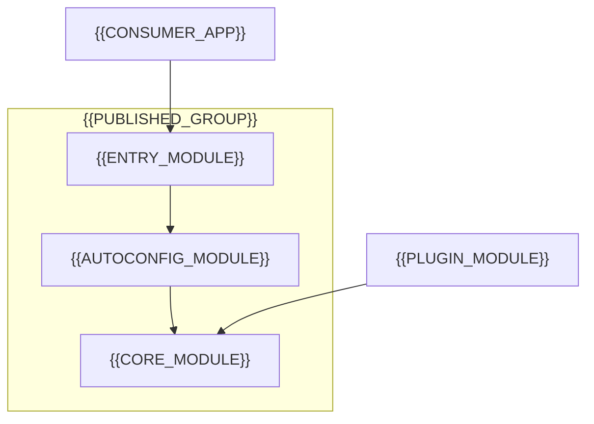

# Plugin & Module Architecture

[← Table of Contents]({{INDEX_PATH}}) · *Framework-Library Module*

## Table of Contents

{{TOC_LINKS}}

{{PLUGIN_ARCHITECTURE_SUMMARY}}

## Module Dependency Graph

## Modules

| Module | Artifact ID | Responsibility | Depends On | Published |
|---|---|---|---|---|
{{MODULE_DEPENDENCY_ROWS}}

For a starter-style artifact, split the entry module (dependency descriptor only) from the auto-configuration module (conditional wiring) from the core module (actual functionality), so consumers can depend on core alone.

## Plugin Lifecycle

| Phase | Trigger | Plugin obligations | Failure behavior |
|---|---|---|---|
{{PLUGIN_LIFECYCLE_ROWS}}

## Isolation and Classloading

{{ISOLATION_NOTES}}

## Assumptions and Open Questions

{{ASSUMPTIONS}}

## Self-Check

{{SELF_CHECK_NOTE}}

## Related Docs

- [Extension Points / SPI](extension-points-spi.md)
- [Packaging & Distribution](packaging-distribution.md)
{{RELATED_DOC_LINKS}}
