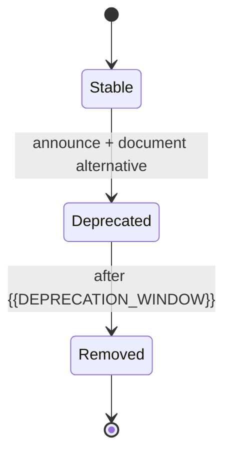

# Versioning & Compatibility

[← Table of Contents]({{INDEX_PATH}}) · *Framework-Library Module*

## Table of Contents

{{TOC_LINKS}}

{{VERSIONING_SUMMARY}}

## Versioning Policy

| Field | Value |
|---|---|
| Scheme | {{VERSIONING_SCHEME}} (e.g. SemVer 2.0.0) |
| Breaking change rule | {{BREAKING_CHANGE_RULE}} |
| Deprecation window | {{DEPRECATION_WINDOW}} |
| Pre-release channel | {{PRERELEASE_CHANNEL}} |
| Support policy | {{SUPPORT_POLICY}} |

## Compatibility Matrix

| Library version | Runtime / platform version | Framework host version | Status |
|---|---|---|---|
{{COMPATIBILITY_ROWS}}

## Deprecation Process

| Step | Action | Artifact |
|---|---|---|
{{DEPRECATION_STEP_ROWS}}

## Migration Guides

| From → To | Breaking changes | Migration guide |
|---|---|---|
{{MIGRATION_ROWS}}

## Assumptions and Open Questions

{{ASSUMPTIONS}}

## Self-Check

{{SELF_CHECK_NOTE}}

## Related Docs

- [Public API Surface](public-api-surface.md)
- [Packaging & Distribution](packaging-distribution.md)
{{RELATED_DOC_LINKS}}
