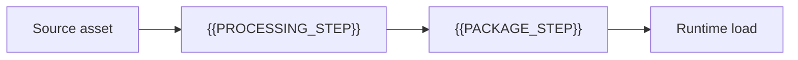

# Asset Pipeline

[← Table of Contents]({{INDEX_PATH}}) · *Game Simulation Module*

## Table of Contents

{{TOC_LINKS}}

{{ASSET_PIPELINE_SUMMARY}}

## Asset Flow

## Asset Catalog

| Asset Type | Source Format | Runtime Format | Budget | Owner |
|---|---|---|---|---|
{{ASSET_PIPELINE_ROWS}}
## Assumptions and Open Questions

{{ASSUMPTIONS}}

## Self-Check

{{SELF_CHECK_NOTE}}

## Related Docs

{{RELATED_DOC_LINKS}}
