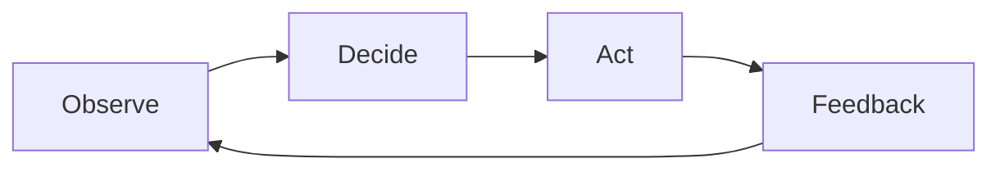

# Core Loop

[← Table of Contents]({{INDEX_PATH}}) · *Game Simulation Module*

## Table of Contents

{{TOC_LINKS}}

{{CORE_LOOP_SUMMARY}}

## Loop Diagram

## Loop Steps

| Step | Input | System Response | Feedback | Risk |
|---|---|---|---|---|
{{CORE_LOOP_ROWS}}
## Assumptions and Open Questions

{{ASSUMPTIONS}}

## Self-Check

{{SELF_CHECK_NOTE}}

## Related Docs

{{RELATED_DOC_LINKS}}
