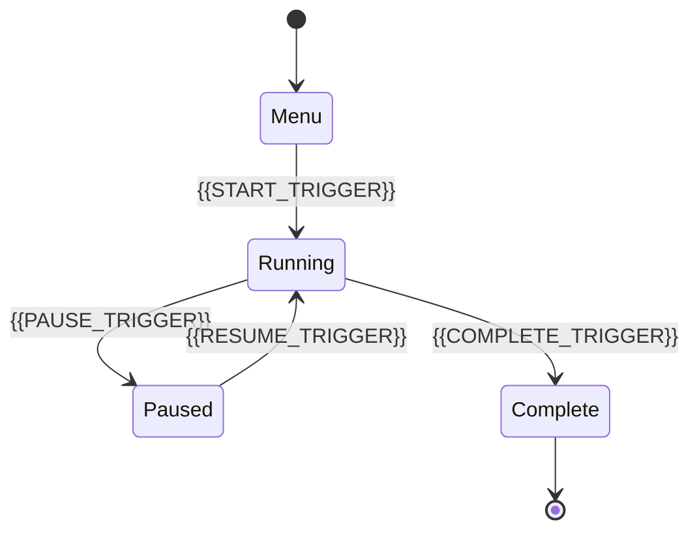

# State Model

[← Table of Contents]({{INDEX_PATH}}) · *Game Simulation Module*

## Table of Contents

{{TOC_LINKS}}

{{GAME_STATE_MODEL_SUMMARY}}

## State Lifecycle

## State Data

| State | Data | Transition | Persistence | Invariant |
|---|---|---|---|---|
{{GAME_STATE_ROWS}}
## Assumptions and Open Questions

{{ASSUMPTIONS}}

## Self-Check

{{SELF_CHECK_NOTE}}

## Related Docs

{{RELATED_DOC_LINKS}}
