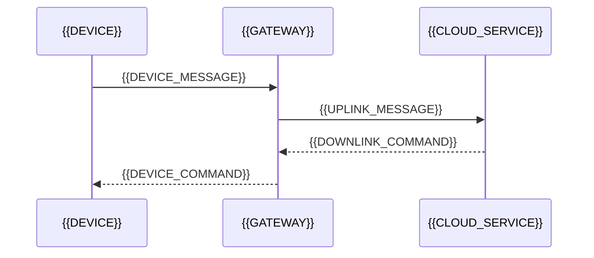

# Device Protocol

[← Table of Contents]({{INDEX_PATH}}) · *IoT Edge Module*

## Table of Contents

{{TOC_LINKS}}

{{DEVICE_PROTOCOL_SUMMARY}}

## Protocol Sequence

## Message Contract

| Message | Direction | Payload | QoS/Retry | Security |
|---|---|---|---|---|
{{DEVICE_PROTOCOL_ROWS}}
## Assumptions and Open Questions

{{ASSUMPTIONS}}

## Self-Check

{{SELF_CHECK_NOTE}}

## Related Docs

{{RELATED_DOC_LINKS}}
